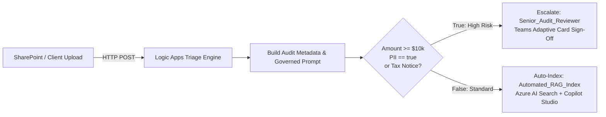
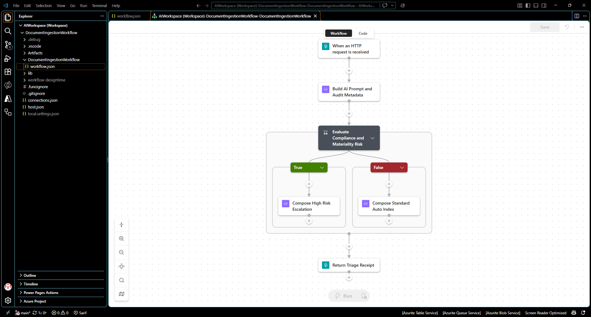

# Enterprise Copilot & Financial Document Triage Workflow

An event-driven **Azure Logic Apps (Standard)** and **Microsoft Power Platform** Proof-of-Concept (PoC) that automates financial document intake, screens for audit materiality ($10,000+ threshold) and PII exposure, and constructs governed system prompts for downstream **Azure OpenAI** and **Microsoft Copilot Studio** agents.

## Architecture & Triage Logic

## Workflow Designer & Compliance Branches

## Repository Structure
* [`AIWorkspace/DocumentIngestionWorkflow/DocumentIngestionWorkflow/workflow.json`](AIWorkspace/DocumentIngestionWorkflow/DocumentIngestionWorkflow/workflow.json) — Stateful Azure Logic Apps (Standard) workflow definition with conditional compliance routing.
* [`docs/PRD_and_Architecture.md`](docs/PRD_and_Architecture.md) — Product requirements, KPI targets, Gherkin acceptance criteria, and NFRs.
* [`deliverables/`](deliverables/) — Client enablement workshop deck and LLM governance brief.
* [`samples/`](samples/) — Verified JSON execution receipts for High-Risk Escalation (`INV-2026-8841`) and Standard Auto-Index (`WP-2026-109`).